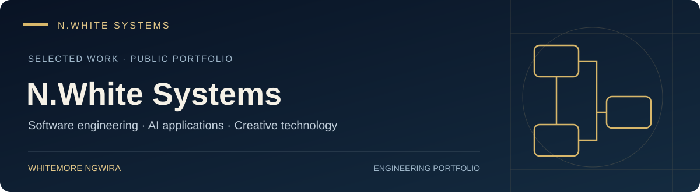

# N.White Systems — Public Portfolio Index

This repository is the sanitised public portfolio index for **Whitemore Ngwira — Principal Technology Architect & AI Systems Engineer**.

> **Confidentiality boundary:** this repository contains portfolio summaries only. Production source code, deployment configuration, database migrations, environment templates, internal operating notes, credentials, client records and commercially sensitive implementation material are kept in private repositories.

## Start Here

| Area | Public link |
| --- | --- |
| Main portfolio | [nwhite.systems](https://nwhite.systems/) |
| Guided portfolio review | [nwhite.systems/portfolio-review](https://nwhite.systems/portfolio-review) |
| Selected work | [nwhite.systems/my-portfolio](https://nwhite.systems/my-portfolio) |
| Services | [nwhite.systems/services](https://nwhite.systems/services) |
| About Whitemore Ngwira | [nwhite.systems/about-me](https://nwhite.systems/about-me) |
| Professional contact | [hello@nwhite.systems](mailto:hello@nwhite.systems?subject=Portfolio%20walkthrough%20request) |

## Software engineering with Claude Code & Codex

I direct **Claude Code** and **OpenAI Codex** across repository understanding, implementation, debugging, testing, review and documentation. I define the scope, make engineering decisions and check results against evidence.

My recent work spans Android kiosk applications, backend and API workflows, web platforms and AI-powered applications. [Explore my engineering approach and visual project gallery](https://github.com/whitemorengwira).

## AI-powered applications

- **[N.White Systems](https://nwhite.systems/):** AI receptionist and conversational portfolio guidance using relevant site information.
- **[ApplyWise AI](case-studies/applywise-ai.md):** AI-assisted career workflows, evidence-grounded assistance and application preparation.
- **[EarCodeX](https://github.com/whitemorengwira/earcodex-case-study):** AI-enabled insurance workflow architecture case study.
- **[Sweet Robo Photo Booth](https://github.com/whitemorengwira/sweet-robo-photo-booth):** my software engineering contribution within an AI-enabled product.

## Sweet Robo · Connected-machine engineering

My work spans Android engineering, hardware–software debugging, integration analysis, backend workflows and quality checks.

[Perfume Machine](https://github.com/whitemorengwira/sweet-robo-perfume-machine) · [Vending Machine](https://github.com/whitemorengwira/sweet-robo-vending-machine) · [Photo Booth](https://github.com/whitemorengwira/sweet-robo-photo-booth) · [Control Centre Engineering](https://github.com/whitemorengwira/sweet-robo-control-centre-engineering)

Official public product context: [Sweet Robo](https://sweetrobo.com/) · [Futureino](https://futureino.ai/).

## Selected Sanitised Case Studies

<table>
<tr>
<td width="50%" align="center" valign="top">
<a href="https://github.com/whitemorengwira/socinga-africa-enterprise-case-study"> <strong>Socinga Africa</strong></a> 
Multi-division enterprise website and stakeholder information architecture.
</td>
<td width="50%" align="center" valign="top">
<a href="https://github.com/whitemorengwira/earcodex-case-study"> <strong>EarCodeX</strong></a> 
Insurance architecture, AI document workflows and reconciliation case study.
</td>
</tr>
<tr>
<td width="50%" align="center" valign="top">
<a href="https://github.com/whitemorengwira/sam-dossier-case-study"> <strong>SAM Dossier</strong></a> 
Mining-investment dossier concept, dashboards and document-workflow design.
</td>
<td width="50%" align="center" valign="top">
<a href="https://github.com/whitemorengwira/nwhitesystems/blob/main/case-studies/safa-promax.md"> <strong>SAFA ProMax</strong></a> 
Board-facing creative technology, structured content and stakeholder experience.
</td>
</tr>
</table>

*Generated portfolio visuals; product screenshots, where available, are separately labelled in each case study.*

| Project | Public evidence | Confidentiality posture |
| --- | --- | --- |
| SAFA ProMax | [Case study](case-studies/safa-promax.md) · [Live artefact](https://safa-promax.vercel.app/) | Implementation repository is private. |
| EarCodeX | [Sanitised case study](https://github.com/whitemorengwira/earcodex-case-study) · [Live artefact](https://earcodex.vercel.app/) | Product internals and operational workflows remain private. |
| Socinga Africa | [Sanitised case study](https://github.com/whitemorengwira/socinga-africa-enterprise-case-study) · [Live artefact](https://www.socinga.africa/) | Production implementation and internal operations remain private. |
| SAM Dossier | [Sanitised case study](https://github.com/whitemorengwira/sam-dossier-case-study) · [Live artefact](https://sam-dossier.vercel.app/) | Investor, document and platform internals remain private. |

## Repository-Only Engineering Notes

Read the [N.White Systems engineering-notes collection](docs/engineering-notes/README.md) for three source-pinned technical studies covering repository publication hygiene, explicit service-worker caching and nullable operational measurements in TypeScript. These notes are maintained on GitHub rather than published on the N.White Systems website.

## Technical Focus

- Systems architecture and digital-platform design.
- Full-stack web and SaaS delivery.
- AI-assisted workflow architecture and automation.
- Analytics, reporting and operational visibility.
- API-led integration and cloud-first deployment.
- Creative technology, multimedia systems and public-facing digital experience.
- Governance-conscious delivery for regulated or sensitive environments.

## What Public Evidence Shows

Public portfolio material may show the business problem, my role, high-level architecture, approved visuals, live public experiences, non-sensitive verification and delivery judgement.

It does **not** publish:

- production or client source code;
- credentials, environment-variable inventories or private endpoints;
- database schemas, migrations or administrative logic;
- authentication, authorisation or security-control implementation;
- internal agent instructions, handover notes or operational documentation;
- stakeholder, investor, student, client or user records;
- confidential strategy, commercial records or proprietary workflow details.

## Private Technical Review

Source-level proof can be provided through a controlled walkthrough, private repository access or an agreed confidentiality arrangement where permission allows. Public GitHub is reserved for deliberately sanitised portfolio material.

## Publishing Standard

Read the [Public Portfolio Disclosure Policy](PUBLIC_DISCLOSURE_POLICY.md) before publishing or linking any repository from the portfolio.

## Usage Rights

This repository is public for portfolio review only and is not open-source licensed. See [COPYRIGHT.md](COPYRIGHT.md) for usage boundaries.
