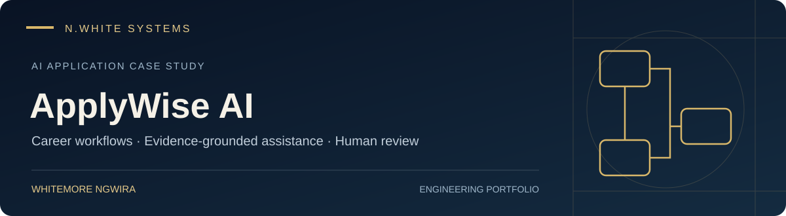

# ApplyWise AI — AI-assisted career workflows

**By Whitemore Ngwira · N.White Systems**

ApplyWise AI is my engineering project exploring how AI can support the work around a job application: understanding a role, comparing it with career evidence, preparing application material and practising for interviews.

This is a high-level portfolio summary. The title artwork is illustrative and does not show a product interface.

## The problem

Useful career assistance needs more than fluent text. It needs relevant evidence, a clear understanding of the role, visibility into uncertainty and an opportunity for a person to review the result. Application material should describe real experience accurately.

## My engineering focus

- **Full-stack application design:** shaping the interface and service workflows around practical career tasks.
- **Evidence-grounded assistance:** connecting career questions and draft responses to relevant background material.
- **AI workflow orchestration:** separating analysis, drafting and review into understandable steps.
- **Application preparation:** supporting job-description analysis, candidate alignment, CV and cover-letter drafting, and interview preparation.
- **Human review:** treating generated text and recommendations as drafts to be checked before use.

## What this demonstrates

| Hiring lens | Engineering focus |
| --- | --- |
| AI application engineering | Connecting model-assisted tasks to a useful application workflow |
| Product judgement | Designing around evidence, user intent and review |
| Full-stack delivery | Bringing interface, services and AI-assisted workflows together |
| Responsible automation | Keeping factual accuracy and human decisions central |

## How I use AI in engineering

Across my software practice, I direct **Claude Code** and **OpenAI Codex** for repository understanding, implementation, debugging, testing, review and documentation. My [engineering workflow](https://github.com/whitemorengwira#software-engineering-with-claude-code--codex) explains this approach. It is distinct from the AI features an application offers its users.

## Review boundary

This summary describes the project's focus; it does not certify production readiness, application outcomes, accuracy rates or deployment scale. Personal career records, prompts, internal configuration and implementation details are outside this case study.

[View my profile](https://github.com/whitemorengwira) · [Explore N.White Systems](https://nwhite.systems/) · [Request a walkthrough](mailto:hello@nwhite.systems?subject=ApplyWise%20AI%20portfolio%20walkthrough)
